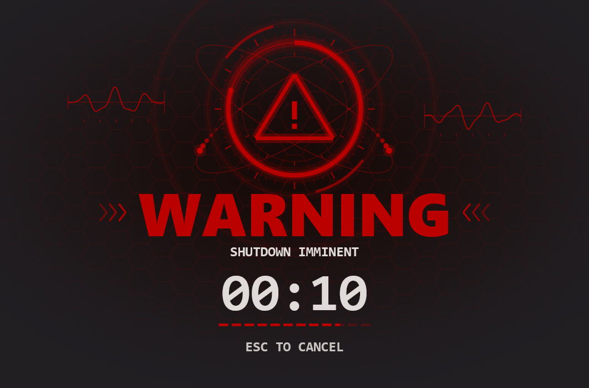
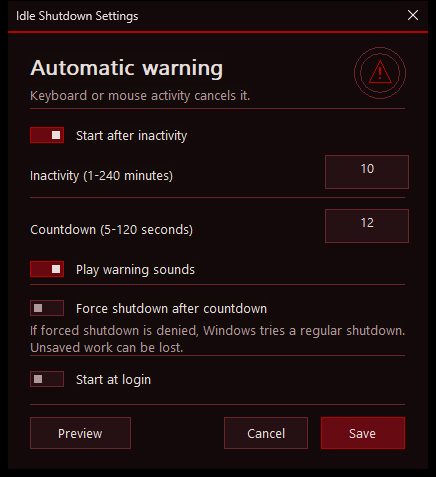

# Idle Shutdown

### English

**Dozed off at your computer? Idle Shutdown can turn it off for you.**

Enable automatic shutdown and choose how long your PC should wait without keyboard or mouse activity. Before turning off, it shows a full-screen countdown on every monitor. If you're still at your desk, press a key or click the mouse before the countdown ends to cancel. Available for Windows and Arch Linux.

### Русский

**Задремали за компьютером? Idle Shutdown может выключить его за вас.**

Включите автоматическое выключение и задайте, сколько компьютер должен ждать без ввода с клавиатуры и мыши. Перед выключением на всех мониторах появится полноэкранный обратный отсчёт. Если вы ещё за компьютером, нажмите клавишу или кликните мышью до конца отсчёта, чтобы отменить выключение. Приложение доступно для Windows и Arch Linux.

### Polski

**Zdarzyło Ci się przysnąć przy komputerze? Idle Shutdown może go za Ciebie wyłączyć.**

Włącz automatyczne wyłączanie i ustaw, jak długo komputer ma czekać bez używania klawiatury lub myszy. Przed wyłączeniem na wszystkich monitorach pojawi się pełnoekranowe odliczanie. Jeśli nadal jesteś przy komputerze, naciśnij klawisz lub kliknij myszą przed końcem odliczania, aby anulować wyłączenie. Aplikacja jest dostępna na Windows i Arch Linux.



## Quick start

1. Install the build for your system and open **Idle Shutdown Settings** from the tray.
2. Turn on **Start after inactivity** and set the idle period and warning countdown.
3. Click **Preview** to try the animation and sound. Preview is a simulation.
4. To allow automatic power-off, enable **Force shutdown after countdown** and click **Save**. After zero, the app finishes the animation and requests power-off. Forced shutdown can discard unsaved work.

**Start at login** is opt-in. The checkbox reflects the startup registration managed by the desktop.



The screenshots show the Windows interface and warning overlay.

## Install

Get the installer or package from the build artifacts on GitHub Actions or from a published release.

| Platform | Installer or package | Supported environment |
| --- | --- | --- |
| Windows x64 | `IdleShutdown-Setup-1.0.8-x64.exe` | Windows 10 version 1703 or newer |
| Arch Linux x86_64 | `shutdown-warning-1.0.8-1-x86_64.pkg.tar.zst` | X11 or a supported Wayland compositor |

### Windows

Run the installer under your own account. Its default path is `%LOCALAPPDATA%\Programs\Idle Shutdown`. An existing installation keeps its location and settings. Windows may list an existing startup entry under the previous name **Shutdown Warning**.

Use **Settings → Apps → Installed apps** or run the generated `Uninstall.exe` from the installation folder to remove the app. The portable executable can open or reopen settings with `ShutdownWarning.exe --settings`.

During an automatic power-off, the final animation fades to black across all monitors. Once Windows accepts the shutdown request, Idle Shutdown asks Windows to turn the displays off.

Small mouse movements are ignored when measuring inactivity and during the automatic countdown. A deliberate mouse movement, a click, scrolling, or a key press registers as activity. If Raw Input registration fails, the app uses Windows' standard idle detection.

### Arch Linux

```bash
sudo pacman -U ./shutdown-warning-1.0.8-1-x86_64.pkg.tar.zst
shutdown-warning --settings
```

Run `shutdown-warning` to start in the background. The desktop menu also opens settings. If your desktop has no tray host, keep the settings window open for automatic warnings. Remove the package with `sudo pacman -R shutdown-warning`.

On X11, Idle Shutdown ignores small movements from relative mice when measuring inactivity and during the automatic countdown. Keys, clicks, and scrolling still count immediately. On Wayland, the compositor's idle protocol reports activity without identifying the device or the amount of movement, so any activity reported by the compositor still resets the timer.

<details>
<summary>Wayland, Quickshell, and Hyprland startup</summary>

On Wayland compositors with `ext-idle-notify` v2, keyboard and mouse inactivity still counts while a video keeps the display awake. Other sessions use KIdleTime. The tray requires a StatusNotifier host on Wayland or a supported tray on X11. If your Quickshell configuration hides new icons, check its tray overflow.

Hyprland uses a user systemd service for **Start at login**. If your configuration does not start the graphical session target, add this line inside the existing `hyprland.start` handler and log in again. The command respects the **Start at login** setting.

```lua
hl.exec_cmd("/usr/bin/shutdown-warning --autostart")
```

On Linux, if the OS rejects the forced request in a way that permits a fallback, the app tries an ordinary shutdown. The final request depends on the session's systemd-logind and polkit permissions.

</details>

## Build from source

<details>
<summary>Windows x64</summary>

Install CMake 3.24+, Visual Studio with **Desktop development with C++**, the Windows 11 SDK (10.0.22000.0 or newer), and NSIS for the installer.

```powershell
cmake --preset windows
cmake --build --preset windows
ctest --preset windows
pwsh -File ./packaging/windows/build-installer.ps1
```

The executable is in `build/windows/Release`. The installer is in `dist`.

</details>

<details>
<summary>Arch Linux x86_64</summary>

From a local checkout:

```bash
sudo pacman -S --needed base-devel
makepkg -si
```

For a direct CMake build, first install the dependencies listed in `PKGBUILD`, then run:

```bash
cmake --preset linux
cmake --build --preset linux
ctest --preset linux
```

</details>

The Windows and Linux builds use their desktop APIs and share audio synthesis in `app/common`. CTest checks the generated audio, and the Linux build includes an offscreen rendering test. GitHub Actions builds and uploads both packages as artifacts.
